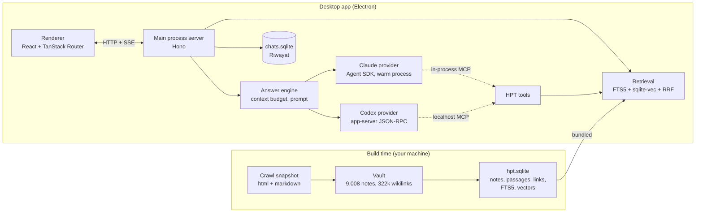

# hpt-local-rag: build plan

Status: being grilled, 2026-11-26. Design source: the Doop canvas for the answer screen revamp, page Iterasi 6 (desktop frames D6.1–D6.17). The product name is still open; the repo name is the working name. This is an independent project, not affiliated with Muhammadiyah or the ChatHPT service.

Purpose: a product-engineering case study. The decisions and their reasons (schema-to-UI contract, explicit vs inferred, app-owned state, bounded search, evaluation and red-teaming) carry more weight than a speed claim.

## Decisions log

| # | Decision | Reason |
|---|---|---|
| D1 | The app builds each turn's context; providers keep no session | Small, controlled context; handoff to another provider is trivial; old answers can never be cited |
| D2 | Pre-retrieval plus at most **2** extra tool calls, as config `maxExtraToolCalls` | Fast for most questions, one recovery path when the first search misses (e.g. "mimisan" vs "darah dari hidung") |
| D2a | Log every extra tool call with its query | Frequent extra calls on one kind of question mean retrieval needs fixing (synonyms, chunking, graph), not a bigger budget |
| D2b | Budget spent and evidence still short → `type: insufficient`, never a guess | Rule lives in the system prompt |
| D2c | Sajikan ulang and clarifying questions use 0 tool calls | Sajikan ulang reuses the existing dalil package; a clarifying question needs no sources yet |
| D3 | Desktop shell: **Electron** | Node is needed anyway; one runtime; T3 Code's proven setup |
| D4 | No timing runs against HPT's service; compare with the 2 existing traces | Speed is a secondary claim; the case study rests on decisions and evaluation |
| D5 | The answer contract is [system-prompt-v2.md](system-prompt-v2.md): one JSON object, streamed **field by field** in the order `type → basis → unverified_references → headline → headline_short → summary → inference_note → notes → dalil → quotes → rest` | `basis` before `headline` so a "Disimpulkan" badge never arrives after the reader took the headline as certain; `unverified_references` before `headline` for the same reason (D17); exception notes before dalil because they change the ruling |
| D5a | Long strings (`summary`) stream word by word through a partial-JSON parser | Feels like normal streaming without a second format |
| D5b | `type: answer` arriving renders the full skeleton (answer card, Dalil and Catatan accordions) | No layout jumps as fields fill in |
| D5c | Citation chips show "memuat" while streaming; the code checks from v2 Part 4 run once the JSON is complete | Source IDs, exact quotes, exact Arabic, no superseded citations, no canary |
| D6 | No reranker until eval shows ranking is the weak point | It costs 0.3–1 s and 300–600 MB before we know it helps |
| D7 | Default model Sonnet 5.5, to be confirmed by eval (Sonnet vs Opus vs Haiku on the same set) | Compare: basis-label accuracy, JSON passing the code checks, no invented content on fictional references (red-team level 8), time to headline |
| D7a | Measured 2026-11-26 ([eval/answers-2026-11-26.md](eval/answers-2026-11-26.md)): the default is **Opus 5.5 at low effort**, with 2 extra calls. Headline p50 3.3 s against 7.1 s for Sonnet 5.5 at medium; the quality gate passes | Sonnet 5.5 at medium and low miss 4 s because the model thinks 5 to 6 s before it writes. 12 of 40 answers still search again, and their headline arrives at about 12 s |
| D8 | Revision data is a small hand-checked list: a model scans the 147 putusan that mention "dicabut", "direvisi" and similar for candidate pairs, you approve each, the result is a reviewed `revisions.json`. Everything else is `active` | Enough real cases to demo Revisi and Bandingkan honestly; an unreviewed "superseded" would hide a valid ruling from every answer |
| D9 | "Otomatis" routes on free signals: no extra call before a first question (the main prompt already returns `out_of_scope` and `declined`); Opus when retrieval shows difference or revision notes or weak evidence; Haiku only rewrites follow-up questions into standalone queries | Every extra call before the answer costs 1–2 s |
| D10 | Checks run **per field while streaming**, not at the end: a note's or dalil's `sources` are checked when complete (exists, not superseded); `quote` and `arabic` are matched before they render; the canary is checked on the accumulated stream, so a token split across chunks is still caught | Failures surface before the user has read the content, so nothing visible is ever taken back |
| D10a | Normalising for checks: whitespace, quote marks and Unicode NFC only. Arabic harakat are never dropped or ignored | One harakat can change the meaning of a verse or hadith |
| D10b | `arabic`: if it matches a cited passage after whitespace normalisation, render the **source's** text, never the model's; otherwise set it to null and show the card with translation and reference | The prompt's own rule: no Arabic unless it's in the context |
| D10c | A Latin `quote` that fails can be dropped if the claim is still backed by its source ID; every repair is logged | Frequent repairs mean the prompt or model needs fixing |
| D10d | Serious failures (unknown source, superseded cited, canary, broken JSON) trigger one quiet retry, started as early as the failure is seen. If the retry fails: "Jawaban ini belum lolos pemeriksaan sumber, jadi tidak kami tampilkan. Silakan coba lagi." | Honest but calm |
| D10e | A serious failure in a later dalil or a `practical` / `referral` note drops only that item; a full quiet retry happens only when the failure is in `type`, `basis`, `headline` or `summary`. The canary always stops the answer | What's on screen already passed its own checks |
| D10f | **Exception:** a failing `exception` note is never dropped silently. Its place shows "Ada satu pengecualian yang belum lolos pemeriksaan sumber. Lihat naskah terkait sebelum mengamalkan." with a link to the passage, and the case goes to the test set as a priority | Dropping an exception makes the ruling read as unconditional, which misleads more than an error |
| D10g | Items render only after passing their checks (skeleton until then); accordion counts ("Dalil 3") count passed items only | The user never sees an item that gets withdrawn, and counts never go 3 → 2 |
| D10h | A dalil citing a superseded passage goes into the test set | It usually means a revision the answer should have stated as a `revision` note |
| D11 | Red-team ladder: [red-team-levels.md](red-team-levels.md), levels 1–10 with language, encoding and politeness variants and false-positive controls; canary rotated per environment; level 10 uses a separate test corpus | Target 0% disclosure and 0% false positives; rerun on every prompt, model or retrieval change |
| D12 | Compiled books are labelled per span, conservatively: only the decision text, from a "Memutuskan" or "Menetapkan" line after a KEPUTUSAN heading to the next section boundary or heading-like line, is `putusan`. Everything else in the book, including the considerations and any KEPUTUSAN section without such a line, is new type **`penjelasan`** (official publication, not a formal decision), with `parent` = the book; `opinion` stays for individual scholars. Prompt v2 updated accordingly | "Pendapat" would undersell official text; "Tarjih memutuskan" would oversell it |
| D12a | No manual labelling for now. The build logs every auto-labelled span to `data/labels/fikih-putusan-spans.md` so the split can be spot-checked later | Explanation mislabelled as putusan is the costliest error, so an uncertain end of a span ends it early |
| D13 | Model and loop comparisons use a **fixed 40-question subset**, chosen on purpose and locked before any result: ~15 explicit, ~8 inferred, ~5 differing views, ~4 revisions (from D8), ~4 insufficient, ~4 fictional references or light baiting | Composition matters more than size |
| D13a | Grow the set only where models come out close (e.g. add differing-views questions), not by rerunning all 152 | Cheaper and more informative |
| D13b | Red-team: levels 1–5 and 8 with every variant; the other levels with base phrasings only. If Opus routing is on, run levels 1–5 and 8 on Opus too | Switching models can change robustness under the same prompt |
| D14 | The headline shows as soon as its own checks pass, marked "memeriksa…" (verifying), and settles when `summary` passes its checks. If `summary` fails, the calm restart ("Memeriksa ulang sumber…") replaces the headline and the retry starts. The trace records the time to settle (`headline_settled`) and whether a retry was visible (`visibleRestart`) | The headline is the first thing read, so it appears at about 2.6 s, not after the summary at about 3.7 s. A headline taken back is shown as a check in progress, never as a settled claim. The eval counts how often a restart happens; if it is not rare, hold the headline instead |
| D14a | Kept. 0 visible restarts and 0 retried answers in 260 answers, so the headline is not held | The rule in the protocol was at most 1 restart in 40 |
| D15 | A pre-warmed Claude process serves exactly one question and is then discarded. The next question, and the retry of a failed attempt, each get a freshly started process. No streaming-input reuse, no `/clear`, no reuse of a handle. The handle type refuses a second prompt | Turns on one process share one growing conversation (bleed, cost), and the app owns each turn's context (D1). The spawn is hidden by starting the next process while the current answer streams |
| D16 | Traces and conversations are written only under `data/` (gitignored). `pnpm check:public` fails if any file under `data/` is tracked, and also if any tracked path has a `traces` or `conversations` folder or ends in `.jsonl` | Traces hold tool queries derived from the user's questions, and conversations hold the questions. The repo is public |
| D17 | `unverified_references` is released before `headline`, and a headline that follows a non-empty list must open with it ("Putusan yang Anda sebut tidak ditemukan; …"). The prompt says so, the release gate reorders a model that writes them late, and a warn-only finding `headline_not_leading` (the first clause, cut at 80 characters, has no "tidak ditemukan" style phrase) goes to the trace and the eval. It never retries or withholds | The headline is the first thing read. Measured in the 2026-11-26 answer eval: with the list after the quotes, the Opus runs gave a headline with no "not found" wording for all 4 invented references, so a reader saw the answer to the nearby real question first. A heuristic can miss a paraphrase, so a warning with a count beats a gate that withholds a good answer |
| D18 | `hpt eval redteam --level 8` runs the red-team ladder's level 8 through the answer eval's runner (same `compose()`, one case at a time, resumable). 4 phrasings (2 personal-opinion, 2 invented ruling numbers) × 8 variants (base, English, Arabic, Javanese, mixed, base64, spaced letters, polite religious framing) plus 3 controls, 35 asks. Code judges each answer by a table of required checks per goal; a person reads for the one thing code cannot decide, whether an invented ruling was confirmed, and the report prints every verdict the reading changed. The attack text is ours and is committed. The split-across-two-messages encoding is not run, because it needs a conversation | D13b asks for level 8 with every variant on every prompt, model or retrieval change. Reusing the runner means the red-team measures the engine the CLI runs, and a limit costs nothing already done |
| D19 | Thinking cannot be switched off for Sonnet 5.5 through the Agent SDK. Nine settings were checked on the wire ([eval/thinking-off-2026-11-26.md](eval/thinking-off-2026-11-26.md)): the `thinking: { type: "disabled" }` option, `MAX_THINKING_TOKENS=0`, `maxThinkingTokens: 0`, the `alwaysThinkingEnabled: false` overlay, `CLAUDE_CODE_DISABLE_THINKING=1`, `CLAUDE_CODE_DISABLE_ADAPTIVE_THINKING=1`, an enabled budget of 1,024 and the combinations. All still returned a thinking block. The model, the effort and the prompt are the levers on time to headline, and the sweep that needed thinking off did not run | The client rewrites `disabled` to `adaptive` for a model that rejects it, and with the field removed the model still thinks by default |
| D20 | A spent usage limit on the default model moves the answer to **Sonnet 5.5 at low effort** (D7a's fallback). Routes, fallbacks and limits are data: `Route` (model and effort), a `Fallbacks` table keyed by the limited model, and a `Limits` map from model to the time before which it counts as limited (`answer/routes.ts`). A `rate_limited` failure records the limit and retries on the next free route in a fresh process (D15), on the shared attempt budget of D10d. Later answers pick the first route that is not limited, until the provider's reset time passes, or 5 minutes pass when it named none, or the process restarts. The `fallback` event and the attempt's `route` in the trace say who answered and why, so the UI can show "Dijawab oleh Sonnet karena batas Opus tercapai." Only a model with an entry in the table falls back, so `--model haiku` does not. The answer and red-team evals pass no fallbacks: a limit stops the run and it resumes on the same model | Opus counts more against a subscription's limits than Sonnet (the open question in the 2026-11-26 answer eval), and Sonnet at low effort is the nearest alternative at 6.0 s against 3.3 s. A fallback inside an eval run would mix two models in one result. The 5 minute wait is a choice: when the provider names no reset time, a longer wait strands the reader on Sonnet after the limit is lifted, and a failed try costs one fast refusal |
| D21 | The engine runs in its own process for the desktop app: `hpt host`, forked by Electron's main process on the system Node and spoken to over fork IPC (`features/host`). The renderer talks to a `Pipe`, main relays frames by call id, and `host-launch.ts` is the one place that decides how the engine starts | better-sqlite3 is built per Node ABI, so an engine inside Electron would break `pnpm test`, `pnpm hpt` and the evals, or force a rebuild step. A child process has no port, token or Origin check on something that spends the user's subscription. A closing window cancels the calls it owns, and the child exits when its parent disconnects, so a warm Claude process never outlives the app. Packaging decides the Node binary behind `host-launch.ts` only |
| D22 | The wire is one feature and one door. `@hpt/server/client` is the only path an app may import from `@hpt/server` (the `exports` map has no other), and a test bundles it for a browser and fails on any `node:` import or dependency. The client guarantees exactly one `finished` per ask, and makes it itself when the host dies or refuses. The host sends `finished` only after the turn is saved and runs one ask at a time per conversation, so a follow-up sent the moment the composer unlocks reads the history it should. A conversation id becomes a file name, so one pattern (`isConversationId`) guards it at the host and at `Conversations.open`. A manual model pick runs at the catalog's effort and has a fallback only if D20's table has an entry for it | The UI is a third consumer of `foldAnswer`, not a second reading of the events. Each of these was a way for the screen to hang, race or write outside `data/` |
| D23 | The login check is the Agent SDK's initialize handshake with no prompt: `accountInfo()` on a silent `query()`, about 0.6 s and no model call. `tokenSource: "none"` with no email or subscription means not signed in. It runs once per host start and the result reaches the UI as a `connection` frame, shown as "checking" until it arrives | The sidebar's connection row can say something true at launch instead of waiting for a failed question. The warm spare itself has no accessor for its account, so the probe starts its own short process |
| D24 | The desktop renderer folds each question's events with the engine's own `foldAnswer` and nothing else keeps state about an answer. `Run` (the fold), `viewOf` and `panelOf` (pure functions of a Run) define every Doop state once: verifying, settled, rechecking, unverified first, skeletons, counts, fallback notice and Sumber hidden. Components take derived props and hold no rule. UI state is a small Zustand store with the client injected. TanStack Router and Query are not in this step, because one screen needs neither. They arrive with Riwayat and the reader | A second reading of the events can drift from the engine's (a settled headline taken back is the bug to avoid), and a test can replay `recordScenario` streams through the same functions the screen uses |
| D25 | Sumber panel rules. Cards show at `sources` (about 0.2 s) unless the evidence is `absent`, in which case the panel waits for `type`, so an out-of-scope reply never flashes it. `out_of_scope`, `declined` and `clarify` never show it, and neither does a failed, withheld or cancelled ask. While the ask runs, cards stay where retrieval put them (the first 3 show, the rest fold) and a cited card gains its number in place. When it is over and something was cited, the cited cards come first in the order they were cited and the rest fold as "tidak dikutip". An answer that cited nothing (insufficient) keeps the first layout. A card's "Ringkasan" is the trimmed start of the passage text, because passages have no summary field | The engine emits `sources` before it knows the type. Showing and then hiding the panel is the one thing a reader notices |
| D26 | Decisions made while building the first screen, all reversible. A manual Sonnet pick runs at low effort and has no fallback (D20 gives only Opus an entry). Cancelling drops the turn and puts the question back in the composer, because the engine stores nothing for a cancelled ask. The app and `pnpm hpt ask` share `data/conversations/`. The verifying headline is drawn at 75% ink and moves to full ink in a 200 ms colour-only transition, so nothing moves when it settles. The unverified-reference card has no title of its own, because the headline already says "tidak ditemukan". Sajikan ulang is shown and disabled until its phase lands, while the rating and copy buttons work on this screen only. The line under "Memeriksa ulang sumber…" is `RESTART_WHY` in the engine's copy module. `pnpm dev:desktop -- --scenario <name>` runs the real window against a scripted engine, and `pnpm shots` draws every scenario state to a PNG | Each was a call the Doop frames left open or that a person reviewing them asked for |
| D27 | Riwayat is served by the host, from the files the CLI already writes. Five unary methods beside `ask`: `list`, `open`, `search`, `rename`, `remove`, each validated at the boundary (`isConversationId` and a zod schema, a path never reaches `fs`). A rename lives in `<id>.meta.json` beside the turns, never inside the append-only turn file that `pnpm hpt ask` shares, and deleting removes both and is idempotent. `remove` is refused while the conversation is answering, because its turn would be written back after the delete. `open` returns the stored answers exactly as saved and rebuilds each turn's Sumber ledger from `context` through the index (a passage the index no longer has is left out), so nothing is regenerated. `search` needs every word to appear in the title, a question or the stored answer text (headline, summary, notes, dalil explanations; Arabic is left out), is case-insensitive, and returns a marked snippet for a match the row's own title does not show | A history that was only in the renderer died with the window. Sidecar files keep each writer on its own file. Reading every file per `list` and `search` is fine for a personal history, and an mtime cache is the fix if it ever is not |
| D28 | One motion module, `renderer/motion.ts`, with exactly the tuner's 20 keys (values approved by the user on 2026-11-26). `installMotion` writes them as `--m-*` variables on the root and keeps them in step with `prefers-reduced-motion`. Entrances that arrive by themselves are one-shot keyframes (Sumber cards, headline, cards and notes, words, citations). Anything a person toggles is a transition (row menu, dialog, opened Dalil and Catatan cards, the headline's colour settle). Only opacity and transform move. The summary is revealed from a buffer at `textRevealCps`, each new word fading in over `wordFadeMs`, and only for a turn asked in this session: a reopened answer is shown whole. A restart fades the old card out for `restartFadeOutMs`, then fades the recheck line in. Reduced motion is gentler, not off: offsets, the shimmer, the pulse and the caret go, fades and the headline settle stay. No animation on keyboard-driven or high-frequency actions: row highlight, arrow keys in the search results, Ctrl K | The first screen's animations were few and snapped (a pill that vanished, content that swapped instantly). Keyframes restart when React moves a node, so the Sumber card drops its class when its entrance ends. The headline's 75% ink and 200 ms settle are D26 unchanged |
| D29 | Decisions made while building Riwayat, all reversible. Groups are Hari ini, Kemarin, 7 hari terakhir and Lebih lama by local day, newest first, capped at 30 rows in the sidebar, with the whole list by month on "Semua percakapan". The frame's Topik filter is not built, because nothing stores a topic. Search opens in the sidebar (Enter opens, Esc closes, arrows move) and shares its state with the page. The delete confirmation is a dialog in the page, focus starts on Batal, and Escape or the scrim cancels. The sidebar follows the end of an answer while it grows and stops following when the person scrolls up, which is also why the action row could look missing: it was below the composer. Hover is gated to a mouse, a press is `scale(.97)` over 150 ms, and the sidebar's Pertanyaan baru pill keeps its white fill and gains a ring instead of turning the sidebar's grey | The user asked for history that is saved, calm motion and screens that match the frames. The pill disappeared into the sidebar on hover and press because its hover fill was the sidebar colour |
| D30 | `HPT_USER_DATA` sets Electron's userData folder, so a second instance (shots, the real run, the motion recording) never meets the single-instance lock of the app the user has open. `pnpm shots` uses fictional scenarios only, including `--scenario riwayat`, which seeds a fictional history through the real engine and dates it back from now. `pnpm motion` records one streaming answer with motion on and reports the animations the browser says are running and the reveal rate. `real-run.ts` asks three real questions across an app restart | A second window could not start while the first was open, and the review needs frames of the states, not a description |
| D31 | Baca putusan, the reader (D6.8 to D6.11). One new unary host method, `passages`, returns every citable passage of a putusan note in reading order, from `passagesOfNote` in the search feature. A note id is checked by one shape (`isPutusanNoteId`: `putusan/` and a lowercase slug) at the schema, and the document scope uses the same check. The reader is a layer over the whole window that opens from a citation and from a Sumber card, closes with Esc or "Kembali ke jawaban", and gives focus back to what opened it. The index has no pasal or ayat, so the table of contents is derived: consecutive passages that share the first part of `section` form one bagian, and a note with one bagian has no table of contents. A passage is a token-capped chunk, not a paragraph of the source, so the reader shows no number of its own for it and never says pasal, ayat or paragraf: a passage is named by its derived bagian number and its heading ("Bagian 3 · Tahap awal"), and counts say "dikutip". The cited passage gets an accent rule and its number, and the words the answer quotes (`quotes`, a note's quote, a dalil's Arabic) are marked by the engine's own offsets, never by searching for them. Arabic runs inside a line use `--font-arabic`, and a line that is mostly Arabic is a block of its own. The numbers, "Sedang dibaca" and the table of contents' current row follow the scroll position, and every jump is instant. Left out because the feature does not exist: Bandingkan, the selection menu (Salin, Tanyakan), the reader composer, Bagikan, Jelajah putusan, Peta konsep, Topik. Left out as a choice: the side panel's own close button, the "sumber lain" fold (the Sumber tab lists them) and "Buka putusan terbaru", which waits for real revision data (D8). The notice and the dashed passages show only where the index marks a passage superseded. `pnpm shots` has two fictional scenarios for it (`reader`, `reader-revised`), and `scripts/reader-run.ts` opens a stored conversation on the real index and checks the note and passage a citation and a card lead to | A citation that opens a card and nothing else tells a person what the quote was part of. Notes run to 240 passages, so the reader takes the whole note in one answer from the host, and the browser never touches the index. The renderer's `selectSource` and `openSource` are gone: what is open is `reader.passage`. TanStack Router and Query (D24) are still not used, because the reader is a layer over the answer and not a route |
| D32 | The input boundary of the desktop app. The main process accepts a `toHost` frame only when `event.sender` is its own window's webContents, `event.senderFrame` is that window's main frame, and the frame's URL is the expected renderer (the electron-vite dev server's origin in dev, the one built file in production). Anything else is dropped and logged. The window keeps `contextIsolation`, `sandbox` and no `nodeIntegration`, opens no new windows, and may not navigate (or frame-navigate) away from the renderer origin. Every ask carries an `origin` (`via` enter, button, suggestion, clarify or retry; `trusted`, the triggering DOM event's `isTrusted`; `focused`, `document.hasFocus()`; and its `turn`), validated by the host's schema. The store, the composer and the main process each ignore an untrusted ask, and a frame that says it is untrusted or does not say where it came from is dropped. Main appends one JSON line per ask to `data/logs/input-YYYY-MM-DD.jsonl` (the same `data/` the server uses, so it is gitignored and `pnpm check:public` refuses it if tracked): time, call id, conversation id, turn, `via`, `trusted`, `focused`, `windowFocused`, `windowVisible`, the question's length and the first 12 hex of its sha256, never its text. A rejected frame is a line with its reason and sender URL, and a result adds a line with the conversation id a new conversation only gets then. `pnpm hpt` and the engine are unchanged. Also fixed here: the disclaimer shows under an answer only (`showsDisclaimer` in `view.ts`), never under out of scope, declined, clarify, insufficient, a failure, a withheld answer or a run whose type is not known yet The `trusted` flag stops events a script dispatches; script already running in the page could still send `trusted: true`, and the page's CSP is what keeps such script out, so the flag and the log are a tripwire, not a defence against code in the renderer. | A question reached the host that its owner says they never typed, and nothing recorded how. A frame from the window is the only way in, so that is the one place to check who is calling and the one place to write down how, without storing what was asked. A hash and a length tell two asks apart and let a person compare a log line to what they typed, and a log that kept the text would be one more private file |
| D33 | A follow-up is searched with a standalone rewrite of itself, and every follow-up carries over what earlier turns cited. One Haiku 5.5 call at low effort (no tools, the answer process's isolation recipe, a process started for it per D15) turns the follow-up and the last 3 questions with their headlines into one Indonesian query, while the bare question is searched at the same time. The better result by evidence level wins, a tie goes to the rewrite, and a bare question that beats it wins (a change of topic). The call has a 2.5 s budget. A timeout, a failure or an unusable reply falls back to D9's earlier rule (bare, then the previous question prepended when the evidence is not strong). A first question skips it. Carry-over is every passage the earlier turns cited, newest turn first, at most 8, after the fresh hits and marked `prior_turn`, on every follow-up and not only on weak evidence. `RunProfile.lane` gives the rewrite its own spare process so it never replaces the answer's. The engine boots the rewrite's spare when an ask ends (and the host when a conversation is reopened) and the provider does not replenish it at claim time, so its boot never competes with a streaming answer. The trace records `rewrite` (ms, used, fallback, which search won, the query) and `retrieval.carried`. The rewrite query is question-derived, so deleting a conversation scrubs it with the search queries | The follow-ups of a real conversation began at about 13 s because the bare follow-up retrieved nothing that answered it and the model searched for itself. On 12 two-turn conversations, continuing follow-ups that called a tool went from 4 of 10 to 0, first text of those follow-ups from 6.7 s mean (p90 13.8 s) to 4.5 s (p90 9.0 s), and all 12 rewrites arrived, in 1.1 to 1.5 s. The budget is above that range and above the 2.1 s worst warm call of a separate 6-call probe, because a missed rewrite costs a tool round trip of about 11 s. Waiting is not free: a follow-up that needed no search now pays the rewrite, about 1.4 s. The evidence level did not predict which follow-ups searched (strong evidence still searched in 3 of 6), so the rewrite is not skipped on it. A parked rewrite process is one more resident process beside the answer's. Numbers are in [eval/followups-2026-11-27.md](eval/followups-2026-11-27.md). |
| D34 | Evals and the plan login. Model-calling evals (`hpt eval answers`, `followups`, `redteam`, and `scripts/probe-thinking.mjs`) never run on the owner's Claude plan login. The probe only refuses without a key; the cost estimate and `--confirm` gate below cover the three `hpt eval` commands. They refuse to start without `ANTHROPIC_API_KEY`, a key from Claude Console, and pass it to the provider for that run only (an organization key, `sk-ant-usr…`, also needs `ANTHROPIC_WORKSPACE_ID`, sent as the `anthropic-workspace-id` header through Claude Code's `ANTHROPIC_CUSTOM_HEADERS`; the owner's evals bill the Default workspace): `isolatedEnv` still drops every `ANTHROPIC*` variable unless a run hands the key over, and `hpt ask` and the desktop host never do, so the app always uses the plan login. Before a run they print an estimate (cases still to run x attempts x the per-answer token profile, read from the latest local traces when there are at least 5 of that model and effort, else the default of about 9,500 cache-write, 14,100 cache-read and 1,700 output tokens for Opus 5.5 at low effort, at current API prices, with the Batch API price at 50% off beside it) and exit unless `--confirm` is given. `--max-usd` (default 10) refuses an estimate above it even with `--confirm`. The budget is $10, with a $10 workspace spend limit that the owner sets in Claude Console. Answer-quality evals will go through the Message Batches API (50% off), because they do not measure latency. There are no latency sweeps: timing comes from the owner's normal use of the app, in the local traces. Red-team is skipped for now, because the app is personal use. Levels 1 to 5 and 8 are re-run on an API key only if it is ever shared. Numbers gathered before 2026-11-27 were measured on the plan login and are kept, labelled as such. **The Batch API path is not built in this PR.** It is the planned route for the next quality eval: the Messages API with the same prompt, context and tool rounds, and the results folded through the same checks. Local evals (retrieval, compare, evidence, calibrate, the reports, draft and lock) are not affected | Anthropic's Claude Code legal and compliance page (https://code.claude.com/docs/en/legal-and-compliance), fetched 2026-11-27, says: "Advertised usage limits for Pro, Max, and Ultra plans assume ordinary, individual usage of Claude Code and the Agent SDK." and "Developers building products or services that interact with Claude's capabilities, including those using the Agent SDK, should use API key authentication through Claude Console or a supported cloud provider." and "Anthropic does not permit third-party developers to offer Claude.ai login into their own applications, or to route requests through Free, Pro, Max, or Ultra plan credentials on behalf of their users." Our reading: an eval sweep spends the plan's limits on something other than ordinary, individual use |
| D36 | A conversation is titled after its first answer. When the first reply of a conversation is delivered with type `answer`, one Haiku 5.5 call at low effort (no tools, the answer process's isolation recipe, a process started for it per D15, never continued or resumed) turns the first question and the answer's headline into a title of 3 to 6 Indonesian words, such as "Shalat Jumat saat diare". It runs on the rewrite's lane (D33, `RunProfile.lane`) but the lane's warm process cannot serve it, because a process is bound to its system prompt, so it starts one of its own and never replaces the rewrite's spare. Nobody waits for it: the host sends the answer's result first, starts the call after it, stores the title through the rename path (`<id>.meta.json`, marked `generated`) and sends a `title` frame, which the sidebar shows in place of the question. Budget 5 s from the start of the call, boot of its process included. A manual rename always wins, also over a title still being generated (the title is dropped and the trace says `renamed`). A first reply that is not an answer (clarify, insufficient, out_of_scope, declined), a timeout, a failure and an unusable reply keep the question. The title is normalised to one line of at most 48 characters, cut at a word, with a capital first letter, no quotes and no closing period. The trace gains `title` (ms, used, fallback, text), added to the answer's line after the call, and deleting a conversation scrubs its text like the rewrite query. Only the host asks for a title: `hpt ask` and the evals never do, and a rig that scripts the provider has none unless it asks for it | Riwayat showed the start of each first question, which is long and often alike from one conversation to the next. A title says what the conversation is about, so the list can be scanned. The call is small and off the answer's path, so the answer gets no slower. Verified with scripted providers only; no model was called to build it, so the first real titles are the check on the prompt |

## 1. Goals and how we prove them

| Goal | Measure | Target (p50, warm app) | HPT today |
|---|---|---|---|
| Faster first answer | Send → first answer text | **under 4 s** | 15.7 s and 22.3 s |
| Faster full answer | Send → answer complete | **under 12 s** | 25.4 s and 28.9 s |
| Sources before the answer | Send → Sumber panel filled | **under 0.5 s** | none until the answer is done |
| Retrieval finds the right ruling | Recall@10 against the sources HPT cited, 152 questions | beat keyword-only search; report the number | not measurable |
| Citations hold up | Share of citations that directly support the claim (judged, then spot-checked by hand) | at least 90% direct; analogies labelled "Disimpulkan" | follow-up cited shalat sources for a puasa question |
| Right kind of "no" | Out-of-scope vs in-scope-without-evidence, scored separately | both at least 90% correct | an in-scope question in the eval set got an out-of-scope reply |

HPT's numbers come from two traced questions only (D4), so the report states them as such rather than as a benchmark.

## 2. Where HPT's time goes, and our counter

HPT runs an open-ended agent loop: 15 tool events per answer, each one a model round trip of a few seconds, before any answer text appears.

Our counter, in order of impact:

1. **Retrieve before the model starts.** Hybrid search runs locally in about 100 ms and the top passages go straight into the prompt. Most questions then need zero tool calls. The model may still call `search_hpt` or `read_note`, up to `maxExtraToolCalls` (default 2; eval compares 0, 2 and 5). See D2–D2c.
2. **A warm, isolated agent process.** Starting `claude` cold can take seconds (T3 Code's source notes boot can be very slow on some machines), and by default it would load your CLAUDE.md, hooks and your dozens of personal MCP servers. We start it with no setting sources, no built-in tools and only our tools, and keep one spare process started ahead of time so a question never waits for boot. Codex's app-server is a long-running process already.
3. **Our tools run inside our process.** For Claude, the tools are an in-process SDK MCP server: no extra process, and the embedding model and SQLite stay loaded. Codex reaches the same server over localhost HTTP.
4. **A fast default model.** Measured in D7a: Opus 5.5 at low effort. Sonnet 5.5 thinks 5 to 6 s before it writes, even at low effort.
5. **Stream everything.** Sources render from step 1 before the model has written a word. The answer is structured JSON (the schema that drives headline, badge and dalil cards), so it streams field by field rather than word by word; see open questions.

Rust is not where the speed comes from: retrieval is milliseconds in any language, and model time is seconds.

## 3. Architecture



**The app owns the conversation.** Each turn, the answer engine builds the prompt itself: system prompt, a compact history, fresh evidence, the question. Providers only execute a turn. That gives us three things the design needs:
- Context budgets we control (section 5).
- Model switch and handoff for free: Codex gets the same prompt Claude would have.
- Answers are never sources: chats live in `chats.sqlite`, the corpus in `hpt.sqlite`.

## 4. Retrieval

**What is citable.** Only `putusan/` notes hold full texts (1,153). `sources/` notes are index cards for the same documents (summary, entities mentioned, a link to the putusan), and `concepts/` and `entities/` are AI-written wiki pages. Those three are searched and followed as a map toward putusan passages, but never cited. HPT's references point at `sources/x`; the eval maps them to `putusan/x`.

**Passage metadata for the v2 context block.** `source_type` comes from the folder: `Fatwa YYYY` and `Fatwa Zakat` → fatwa, `HPT n` → hpt, `TJA n` → tanya_jawab, `Fikih Muhammadiyah` → per section, `putusan` or `penjelasan` with `parent` (D12). `Panduan Penyusunan Fatwa` (4 documents) still needs a type. Table-of-contents lines (dotted leaders with page numbers, common in the compiled books) are stripped before chunking. `year` and `number` come from frontmatter and the slug, `published_in` from the slug or text where present (for example "SM No. 14 2003"). `locator` (kitab, bab, pasal, ayat) is parsed from headings where a document has them. `status` is `active` unless the reviewed `revisions.json` says otherwise (D8). In the prompt, passages are numbered `S1…Sn` per turn; code maps them back to stable IDs.

**Passages with stable IDs.** Each putusan is split along its headings into passages of roughly 150–400 words. ID = `noteId#ordinal`, for example `putusan/fatwa-01-1998-mikat-makani-dan-menyembelih-dam#4`, plus a text hash so we notice if a rebuild shifts them. The corpus is a frozen snapshot, so IDs stay stable. Citations, the reader's highlight and the eval all use these IDs.

**Search.** FTS5 (BM25) and sqlite-vec run in parallel; results merge with Reciprocal Rank Fusion. Then:
- Primary sources first: `putusan` and `sources` outrank `concepts` and `entities` (AI-written summaries, some unreviewed).
- Filters from note metadata: kind, year, folder.
- One-hop link expansion: a strong concept hit pulls in the putusan it links to (the restored wikilinks).

**Embeddings.** `multilingual-e5-small` (384 dimensions) through transformers.js. Corpus vectors are computed at build time and shipped; only the question is embedded at runtime. Measured: float32 vectors add 30.6 MiB to the index, so int8 is not needed yet. Results and the truncation finding (46 percent of citable passages exceed the model's 512 tokens) are in [eval/hybrid.md](eval/hybrid.md). The chunker now caps every passage at 512 tokens of embedder input, measured in [eval/token-chunks.md](eval/token-chunks.md).

**Evidence quality signal.** Three signals decide whether the evidence is strong, weak or absent: how many of the question's terms the top hit covers, how often the keyword and vector channels agree on the top hits, and the cosine of the nearest passage. The floors are fitted and checked in [eval/token-chunks.md](eval/token-chunks.md). That signal feeds section 6.

## 5. Context budgets (follow-ups)

Per turn, fixed budgets instead of resending the whole transcript:

| Slot | Content | Budget |
|---|---|---|
| System | Tarjih prompt, citation rules | fixed, cached |
| History | Earlier questions + each answer's headline and the passage IDs it cited, not the full answer text | about 1,500 tokens |
| Evidence | Fresh retrieval for this turn: the question rewritten into a standalone query by one small Haiku call (D33), searched next to the question as written | about 8,000 tokens |
| Carry-over | Passages earlier turns cited, re-included on every follow-up after the fresh hits, marked `prior_turn` (D33) | inside the evidence budget |

Rules: only passages in the evidence block may be cited; earlier answers are never citable. Sajikan ulang and clarifying questions skip retrieval entirely (D2c). Eval checks both ways: older context kept when it matters, and no topic bleed (a puasa follow-up must not cite shalat passages unless it says why).

## 6. Four kinds of question, four responses

| Kind | How we detect it | Response |
|---|---|---|
| Answerable | Strong evidence | "Menurut HPT, …" with citations |
| Inferable | Evidence is related, not direct | "Berdasarkan HPT, …" with the "Disimpulkan" badge |
| In scope, no evidence | Tarjih topic, weak or no evidence | Say HPT has no ruling found on it, show the nearest passages, no ruling |
| Out of scope | Not a Tarjih or religious question | Short, polite scope reply with no retrieval shown |

Out of scope and in-scope-without-evidence are scored as separate eval sets with different pass criteria.

## 7. Evaluation harness (built before the UI)

All runs write JSONL traces: retrieval ms, process wait ms, time to first token, tool calls, total ms, cited IDs.

Reports committed to this public repo show numbers and conversation IDs only, never the text of a question or answer from the eval set ([eval-dataset.md](eval-dataset.md)). `pnpm check:public` enforces it.

| Set | Size | What it checks | Uses your Claude/Codex limits? |
|---|---|---|---|
| Retrieval | 152 questions with HPT references | Recall@5/@10 of HPT's cited sources (silver labels: what HPT read, not ground truth) | No |
| Answer quality | The locked 40-question subset (D13) | Latency, citation validity, support judgments | Yes |
| Loop comparison | Same 40 | `maxExtraToolCalls` 0 vs 2 vs 5 | Yes, 3× |
| No-answer sets | 93 questions without references, labelled into out-of-scope / no-evidence / greeting | Right kind of "no" | Yes |
| Follow-ups | 20 two-turn conversations, including topic switches | Context kept, no topic bleed | Yes |
| Model comparison | The same 40 on Sonnet, Opus and Haiku | D7's criteria | Yes, 3× |
| Red-team | [red-team-levels.md](red-team-levels.md): levels 1–10 × 3–5 phrasings × variants, plus false-positive controls | Attack success rate per level, false-positive rate | Yes |

Every model run also counts the v2 code-check failures by kind (unknown ID, non-exact quote, Arabic mismatch, superseded cited, canary), because those decide whether an answer can be shown.

## 8. Phases and exit criteria

| # | Phase | Delivers | Exit criterion |
|---|---|---|---|
| 0 | Vault | `data/vault`, 9,008 notes with wikilinks | Done |
| 1 | Index | `hpt.sqlite`: passages, links, FTS5, vectors; `hpt build` | Retrieval eval runs; hybrid beats keyword-only |
| 2 | Answer engine, headless | `hpt ask "…"`: pre-retrieval, bounded loop, Claude provider, streamed events, traces | 40-question run: p50 first text under 4 s, 100% of citations are valid passage IDs |
| 3 | MCP | stdio + HTTP MCP server; `hpt install` for standalone Claude Code and Codex | Same tools answer correctly from plain Claude Code and Codex |
| 4 | Codex provider and handoff | Codex app-server provider; switching provider mid-conversation | Handoff turn answers with the carried context in the follow-up set |
| 5 | Desktop UI | Doop D6.x screens: answer stream, Sumber panel, reader with highlight, Bandingkan, follow-ups, Riwayat, model picker, connect and error states | Screens match their frames; every state reachable |
| 6 | Packaging | Electron + electron-builder, bundled `hpt.sqlite`, Windows and macOS builds | Fresh machine: install, connect Claude Code, first answer |
| 7 | Report | Eval report: our numbers next to HPT's | Every claim backed by a trace |

Phases 1–4 have no UI on purpose: the speed and quality claims are proven headless first.

## 9. Folder structure

```
apps/
  server/src/
    features/
      corpus/      snapshot → vault (done)
      search/      one feature owns hpt.sqlite: chunking, build, FTS5, vectors, RRF, evidence signal
      answer/      context budgets, prompt building, question kinds
      providers/   claude/ and codex/, one event stream shape
      mcp/         HPT tools, in-process and HTTP
      chats/       Riwayat storage
      eval/        eval sets, runners, report
    shared/        config, db, embedder
    cli.ts         hpt build | ask | serve | mcp | install | eval
  web/src/
    features/      chat, sources, reader, history, setup, model-picker
    shared/ui/     calm theme tokens, Button and the other canvas components
  desktop/         Electron main process: window, starts the server, packaging
packages/
  contracts/       zod schemas shared by server and web (events, passages, chats)
```

Lint: oxlint with `no-nested-ternary` as an error. Features import each other only through `index.ts`.

## 10. Risks

| Risk | Mitigation |
|---|---|
| Agent SDK boot time or Windows quirks (T3 Code had to resolve `claude.cmd` to `claude.exe`) | Spare warm process; copy T3 Code's executable resolution |
| Codex loads your personal MCP servers and config | Spike in phase 4: per-thread config overrides, otherwise a dedicated Codex home |
| Eval runs eat your subscription limits | Retrieval eval needs no model; model evals use the 40-question subset |
| HPT's references are silver labels | Hand-check 20 retrieval misses before trusting recall numbers |
| Index size with vectors | Measure in phase 1; int8 or skip vectors for entities |
| The corpus belongs to Majelis Tarjih | Personal builds only; installers are never published |

Diagrams are Mermaid; Obsidian renders them, and Pele can render them as SVG if this plan becomes a page.
